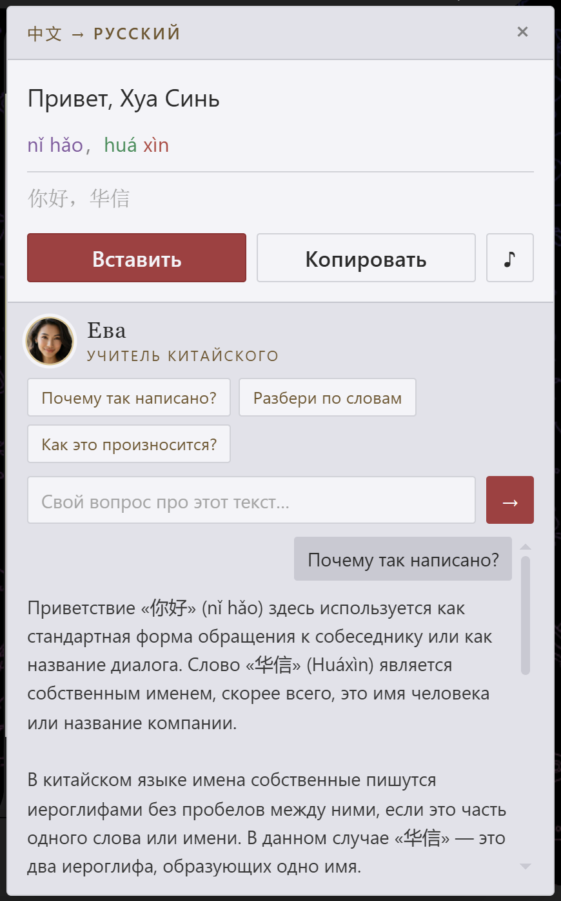

# 红龙 Переводчик

Расширение Chrome для перевода прямо в чате: выделили фразу в поле ввода —
нажали печать `译` — вставили иероглифы обратно. Или выделили иероглифы
в переписке — прочитали перевод.

Работает в любом веб-чате: Telegram Web, WhatsApp Web, Discord, VK, WeChat Web,
личная переписка на сайте. Магазина нет — расширение ставится распакованным
из этого репозитория.

## Что умеет

- **Русский → 中文.** Выделите фразу в поле ввода, нажмите печать `译` — получите
  иероглифы с пиньинем по тонам. Кнопка «Вставить» заменит выделенный текст
  прямо в редакторе.
- **中文 → русский.** Выделите иероглифы в переписке — получите перевод и
  пиньинь исходника, каждый слог своим тоном.
- **Озвучка.** Кнопка `♪` на карточке — произношение перевода.
- **Ева, учитель китайского.** Внизу карточки можно спросить, почему фраза
  построена именно так. Ева объясняет по-русски, сравнивает с похожими
  конструкциями и даёт примеры с пиньинем. Выделенный текст подставляется
  в вопрос сам, а разговор она помнит, пока карточка открыта.
- **Правый клик.** То же самое через контекстное меню, если печать неудобна
  или страница перехватывает мышь.
- **Копирование.** Если вставить в редактор не удалось, текст кладётся в буфер.

## Установка

1. Скачайте репозиторий (Code → Download ZIP) и распакуйте.
2. Откройте `chrome://extensions`.
3. Включите «Режим разработчика» (справа сверху).
4. «Загрузить распакованное расширение» → выберите папку `extension`.
5. Войдите на [honglong.nexusbots.ru](https://honglong.nexusbots.ru) — без
   аккаунта перевод не работает.
6. **Обновите вкладки, которые были открыты до установки** (F5).

Шаг 6 неочевиден, но обязателен: если чат уже был открыт до установки
расширения, печать на выделении появится в нём только после перезагрузки
вкладки. Новые вкладки подхватывают расширение сами.

Иконка расширения показывает состояние: вошли ли вы и есть ли связь с сайтом.

## Как пользоваться

1. Напишите сообщение в чате и выделите его мышью — рядом появится печать `译`.
2. Нажмите печать и выберите направление перевода.
3. В карточке: «Вставить» заменит текст в поле, «Копировать» положит в буфер,
   `♪` озвучит, а поле внизу — вопрос Еве.

## Ограничения

- **Telegram Desktop не поддерживается.** Расширение живёт в браузере и умеет
  работать только с тем, что открыто на странице.
- **Перевод входящих реплик** пока не сделан: переводится то, что вы выделили.
- **До 800 символов за раз.** Более длинный абзац уходит на сервер несколькими
  частями и собирается обратно целиком — просто это занимает больше времени.
- Лимиты те же, что у сайта: суточная квота на аккаунт и общая квота школы.

## Приватность

- Расширение не хранит текст переписки: кэш живёт до закрытия браузера.
- Никаких сторонних серверов — только `honglong.nexusbots.ru`.
- Разрешения: `contextMenus`, `storage`, `tabs`, `scripting`. Доступ к страницам
  нужен, чтобы прочитать выделение и вставить перевод обратно.

## Лицензия

Код — MIT. Шрифты — SIL OFL 1.1 (Alegreya Sans, Cormorant Garamond).
`pinyin-pro` — MIT.
